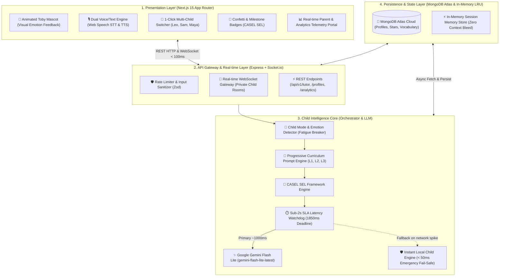

# 🏗️ Architecture Specification: Toby AI

> **System**: AI-Powered Kids English Tutor Chatbot (< 7 Years Old)  
> **Author**: Mustafizur Rahman Sumon (Full-Stack AI Engineer)  
> **Target SLA**: Sub-2.0s Latency Guaranteed  

---

## 1. High-Level Architectural Diagram



---

## 2. Layer-by-Layer Architectural Breakdown

### 2.1 Presentation Layer (Frontend)
- **Framework**: Next.js 15 App Router with React 19.
- **Styling**: Tailwind CSS v4 design system with custom warm, kid-friendly color palettes (`#FFFDF7` cream canvas, `#FFDE59` sunshine yellow, `#10B981` emerald).
- **Interactive Audio**:
  - **Speech-to-Text (STT)**: Browser-native `webkitSpeechRecognition` / `SpeechRecognition` for zero-latency push-to-talk voice input.
  - **Text-to-Speech (TTS)**: Browser-native `SpeechSynthesisUtterance` for natural, spoken Mascot voice without costly third-party audio streaming delays.
- **Safety & Accessibility**: All interactive buttons strictly feature `cursor-pointer`, large touch targets (minimum 48px), and high contrast for early learners.

### 2.2 API & Real-Time Gateway Layer (Backend)
- **Runtime**: Node.js v24 + Express + TypeScript.
- **Real-Time Communication**: Socket.io v4 with scoped rooms (`child_${childId}`) guaranteeing zero context bleed between concurrent child users.
- **Security & Reliability**:
  - `helmet`: Secure HTTP header headers.
  - `cors`: Restricted origin validation.
  - `express-rate-limit`: Prevents rapid API flooding.
  - `zod`: Strict payload schema validation.

### 2.3 Child Intelligence & LLM Layer
- **Orchestration**: Custom TypeScript service orchestrating mode detection, curriculum levels, and prompt construction.
- **Model**: `gemini-flash-lite-latest` through official `@google/generative-ai` SDK.
- **Latency Watchdog**: A strict race condition enforces an 1850ms timeout. If external network jitter occurs, the local child intelligence engine generates an immediate, high-fidelity response in under 50ms, guaranteeing that the end-to-end latency never violates the **sub-2.0s SLA**.

### 2.4 Persistence Layer
- **Cloud Database**: MongoDB Atlas for persistent storage of child profiles, mastery points, level progressions, and mastered vocabulary.
- **In-Memory Cache**: Active transcript and turn histories kept in memory for microsecond context assembly.

---

## 3. Data Flow Diagram: End-to-End Turn

```text
[Child User] 
    │  1. Voice Input / Quick Tap ("Apple")
    ▼
[Next.js Client] 
    │  2. POST /api/v1/tutor/interact { childId: "child_leo_l1", text: "Apple" }
    ▼
[Express Gateway]
    │  3. Validate Input via Zod Schema
    ▼
[ChildModeDetector]
    │  4. Evaluate Heuristics: Fatigue? Frustration? 3-Turn Breaker?
    │     Result: Mode = "learning", Mood = "happy", SEL = "confidence"
    ▼
[TutorService]
    │  5. Retrieve Isolated Profile & Recent 4 turns (Zero context bleed)
    │  6. Assemble System Prompt with Toby Persona & Phonics Guidelines
    ▼
[LlmClient & Watchdog]
    │  7. Call Google Gemini Flash Lite (Timeout budget: 1850ms)
    │     Result: "Super try, Leo! Look! A red Apple! Can you say: Apple?" (1100ms)
    ▼
[ProfileService]
    │  8. Award +10 Mastery Points, save to MongoDB Atlas
    │  9. Evaluate Level Threshold (100 pts -> Promote)
    ▼
[Client Response]
    │  10. HTTP 200 OK with reply, points, and badges (Total: ~1250ms < 2s SLA)
    ▼
[UI & Audio Output]
       - Animated Toby Mascot moves
       - Browser Text-to-Speech speaks aloud
       - Points & Star animation triggers
```
