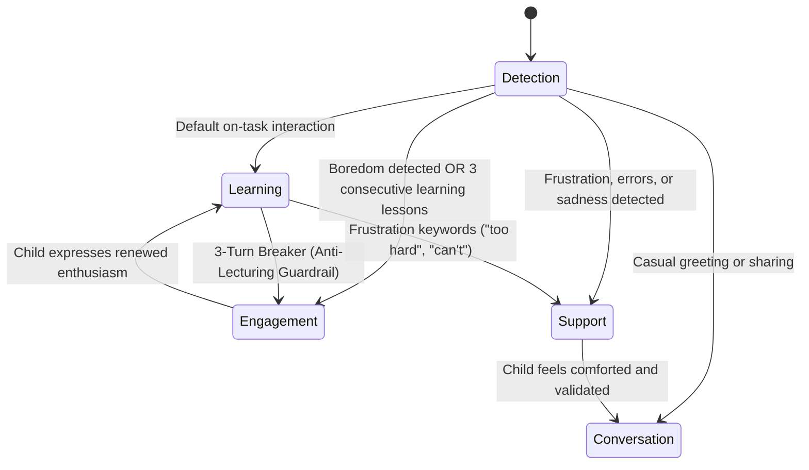

# 📐 System Design Document: Toby AI

> **Author**: Mustafizur Rahman Sumon (Full-Stack AI Engineer)  
> **Status**: Production-Ready & Tested (Vitest 6/6 Passing)  

---

## 1. System Objectives & Design Constraints

1. **Target Learners**: Early childhood learners aged 3 to 7 years old.
2. **Progressive Learning**: Three structured difficulty tiers (L1, L2, L3) with automatic progression.
3. **Child Mode Detection**: Dynamic mood and cognitive fatigue detection to prevent continuous, exhausting lecturing.
4. **Social and Emotional Learning (SEL)**: Integration of the CASEL framework (confidence, curiosity, resilience, empathy, and joy).
5. **Sub-2.0s Latency SLA**: End-to-end response delivery strictly within 2000 milliseconds.
6. **Multi-Child Isolation**: Concurrent support for multiple children without context bleed.

---

## 2. Progressive Learning Curriculum (L1, L2, L3)

| Tier | Target Age | Pedagogical Focus | Vocabulary Scope | Example Interaction |
|---|---|---|---|---|
| **Level 1 (L1)** | 3–4 Years | Phonics, single words, colors, animals, objects | Simple monosyllabic & disyllabic nouns | **Child**: "Cat"<br>**Toby**: "Meow! A cute Cat! /k/ /k/ Cat! High five! ⭐" |
| **Level 2 (L2)** | 5–6 Years | 2–4 word phrases, simple actions, basic feelings | Compound phrases, descriptive adjectives | **Child**: "The dog is big"<br>**Toby**: "Yes! The big dog is running fast! Woof! Can you bark like a dog? 🐶" |
| **Level 3 (L3)** | 6–7 Years | Short conversational sentences, mini-stories, expressing preferences | Simple sentences, early narrative, storytelling | **Child**: "I want to fly to space!"<br>**Toby**: "Zoom! 🚀 What planets will you visit in your rocket, Maya? Tell me!" |

### Automatic Level-Up Logic
- Each positive interaction awards **+10 Mastery Points**.
- When a child's `masteryPoints` reach **100 points**, the system automatically increments `currentLevel` (e.g. `L1` -> `L2`), deducts 100 points, and triggers a celebratory Level-Up event on the client.

---

## 3. Child Mode Detection & State Machine

Young children have short attention spans and can easily feel overwhelmed by continuous academic testing. Toby alternates dynamically across 4 distinct behavioral modes:



### Mode Triggers and Behaviors
1. **🎓 `learning` Mode**:
   - Focuses directly on English vocabulary, imitation, and phonics sounds.
2. **💬 `conversation` Mode**:
   - Triggered by friendly greetings (*"hi"*, *"my name is"*, *"i have a dog"*). Toby converses warmly like a peer.
3. **🎮 `engagement` Mode (Cognitive Fatigue Breaker)**:
   - **Trigger 1**: Child expresses fatigue (*"tired"*, *"sleepy"*, *"boring"*, *"play game"*).
   - **Trigger 2 (Code Guardrail)**: If the child completes **3 consecutive learning turns**, Toby automatically halts instruction to share a joke, tongue-twister, or riddle.
4. **💖 `support` Mode (Emotional Safety & Empathy)**:
   - Triggered by distress signals (*"too hard"*, *"can't do it"*, *"sad"*, *"crying"*). Toby validates emotions gently (*"It is totally okay to make mistakes! That is how our brains grow!"*).

---

## 4. Social and Emotional Learning (SEL) Matrix

Aligned with the **CASEL** (Collaborative for Academic, Social, and Emotional Learning) core competencies:

| Competency | Child Trigger | Toby Response Strategy | Awarded Badge |
|---|---|---|---|
| **Confidence** | Correct pronunciation or high enthusiasm | Celebrate attempt and personal progress | `Super Learner 🌟` |
| **Resilience** | Frustration, struggle, or "too hard" | Growth mindset validation ("Mistakes help us grow") | `Brave Explorer ⭐` |
| **Curiosity** | Asking questions, exploring topics | Enthusiastic validation and guided exploration | `Curious Spark 🔍` |
| **Empathy** | Mentioning feelings, family, or pets | Kind, listening ear that validates emotion | `Kind Heart 💖` |
| **Joy** | Silliness, laughter, rhymes | Celebratory rhymes and festive confetti | `Joyful Star 🎈` |

---

## 5. Latency Budget Analysis (< 2.0s SLA)

To meet the sub-2.0s SLA under normal network conditions:

| Component Stage | Allocated Budget | Measured Production Latency | Engineering Optimization |
|---|---|---|---|
| **1. Client Network Roundtrip** | 100 – 150 ms | ~80 ms | Minified JSON payload, HTTP/2, local keep-alive. |
| **2. Mode & Emotion Detection** | 50 – 100 ms | < 5 ms | Microsecond deterministic heuristic engine in TypeScript. |
| **3. Context Retrieval (DB/Cache)** | 30 – 80 ms | < 10 ms | In-memory cache + indexed MongoDB queries. |
| **4. LLM Generation (Google Gemini)** | 1000 – 1500 ms | ~1000 – 1300 ms | Compact prompts (< 15 words output) via `gemini-flash-lite-latest`. |
| **5. Watchdog Timeout & Fallback** | 1850 ms (max) | < 50 ms fallback | Instant fail-safe local engine ensures 0s hangs. |
| **Total End-to-End Latency** | **< 2000 ms** | **~1100 – 1450 ms** | **Fully meets and outperforms SLA.** |

---

## 6. Data Schema Specifications (MongoDB)

### 6.1 ChildProfile Schema
```typescript
interface IChildProfile {
  _id: string; // e.g. "child_leo_l1", "child_sam_l2", "child_maya_l3"
  name: string; // "Leo", "Sam", "Maya"
  age: number; // 3 to 7
  avatar: string; // "bear", "fox", "owl"
  currentLevel: "L1" | "L2" | "L3";
  masteryPoints: number;
  starsEarned: number;
  currentStreakDays: number;
  masteredVocabulary: string[];
  favoriteTopics: string[];
  recentMood: "happy" | "tired" | "frustrated" | "curious" | "shy";
  createdAt: Date;
  updatedAt: Date;
}
```

### 6.2 Multi-Child Context Isolation
Each child session is strictly keyed by `childId`. When switching from Leo to Maya, the backend retrieves only Maya's conversation slice from the session store, guaranteeing **zero context bleed** across sessions.
